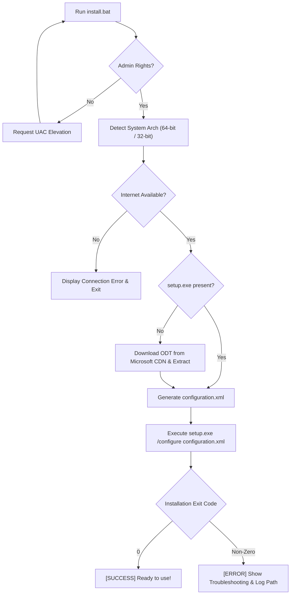

# Microsoft Office Standalone Installer (Word, Excel & PowerPoint)

[](https://microsoft.com)
[](LICENSE)
[](https://learn.microsoft.com/en-us/microsoft-365-apps/deploy/overview-office-deployment-tool)
[-brightgreen.svg)](#)

A fully automated, standalone batch installer that downloads and installs **Microsoft Word**, **Microsoft Excel**, and **Microsoft PowerPoint** directly from official Microsoft Content Delivery Networks (CDN).

Designed to be lightweight, bloat-free, completely legal, and 100% self-contained—requiring no pre-existing setup files or external dependencies.

---

## ⚡ Highlights

- **100% Standalone:** You only need `install.bat`. It automatically fetches the official Microsoft Office Deployment Tool (ODT) and builds the required configuration on the fly.
- **Bloat-Free Installation:** Installs **only** the core productivity suite:
  - ✅ **Microsoft Word**
  - ✅ **Microsoft Excel**
  - ✅ **Microsoft PowerPoint**
  - ❌ *Excludes Access, Outlook, Publisher, Teams, OneDrive, OneNote, Skype for Business, and Bing.*
- **Official & Genuine:**
  - Streams installation binaries directly from Microsoft's official servers (`download.microsoft.com` & `officecdn.microsoft.com`).
  - **No illegal activation, KMS hacks, or cracked files.** Simply sign in with your legitimate Microsoft Account or enter your genuine product key after installation.
- **Automatic Architecture Detection:** Detects whether Windows is running 64-bit or 32-bit and deploys the matching edition automatically.
- **Auto-Elevation (UAC):** Prompts for Administrator privileges automatically if launched without elevation.
- **Pre-Flight Network Verification:** Tests connectivity to Microsoft CDN before initiating setup to prevent download corruption.
- **Detailed Error Handling:** Captures ODT exit codes and provides step-by-step diagnostic advice if an issue occurs.

---

## 🚀 Quick Start

### Method 1: Double Click
1. Download or clone this repository.
2. Ensure your computer is connected to the internet.
3. Right-click **`install.bat`** and select **"Run as administrator"** (or double-click; it will self-elevate).
4. When prompted by Windows UAC, click **Yes**.
5. Wait for the official Microsoft Office installer dialog to complete.
6. Launch **Word**, **Excel**, or **PowerPoint** directly from your Start Menu!

### Method 2: Direct One-Liner (PowerShell)
You can clone and launch the installer directly in PowerShell (Admin):
```powershell
git clone https://github.com/Xmon4u/microsoft-office-installer.git
cd microsoft-office-installer
.\install.bat
```

---

## 🛠️ How It Works (Behind the Scenes)



1. **Privilege Check:** Checks for admin permissions using `net session`. Re-executes with `-Verb RunAs` if not elevated.
2. **Arch Detection:** Inspects `%PROCESSOR_ARCHITECTURE%` and `%PROCESSOR_ARCHITEW6432%` to determine whether 64-bit or 32-bit Office should be deployed.
3. **Internet Check:** Pings Microsoft CDN (`officecdn.microsoft.com`) and public DNS to confirm network stability.
4. **ODT Provisioning:** If `setup.exe` is absent, downloads the official self-extracting executable from Microsoft's download servers and extracts it silently.
5. **XML Generation:** Builds a dynamic `configuration.xml` containing:
   - Target Product: `ProPlus2021Retail`
   - Update Channel: `Current`
   - Excluded applications: `Access`, `Bing`, `Groove`, `Lync`, `OneDrive`, `OneNote`, `Outlook`, `Publisher`, `Teams`
   - Display Level: `Full` (native progress dialog enabled)
6. **Execution & Telemetry:** Launches `setup.exe /configure configuration.xml` and monitors process termination code.

---

## 📂 Repository Structure

```text
├── install.bat          # Master standalone installer script
├── configuration.xml    # Reference XML configuration
├── .gitignore           # Git ignore rules for temporary build/binary files
├── LICENSE              # MIT License
└── README.md            # Documentation and usage guide
```

---

## ❓ Troubleshooting

| Exit Code | Cause | Solution |
| :--- | :--- | :--- |
| **`0`** | Setup completed successfully. | No action required. Apps are in Start Menu. |
| **`17002` / `30088`** | Network timeout or CDN stream interrupted. | Verify your internet speed/stability and re-run `install.bat`. |
| **`1603`** | An older Office setup or process is active in background. | Open Task Manager, end any running `setup.exe` or `OfficeClickToRun.exe`, then retry. |
| **Disk Space Error** | Drive `C:` has insufficient free space. | Free up at least **4 GB** on your system drive. |

> **Diagnostic Logs:** Detailed Microsoft Click-to-Run installation logs can be reviewed in:
> ```cmd
> %TEMP%\*.log
> ```

---

## ⚖️ Disclaimer

This repository does **NOT** provide, distribute, or facilitate any pirated product keys, KMS emulators, or unlicensed software. It utilizes Microsoft's officially documented [Office Deployment Tool](https://learn.microsoft.com/en-us/microsoft-365-apps/deploy/overview-office-deployment-tool) to install genuine Click-to-Run software directly from Microsoft servers. 

Users must activate their software through a legitimate Microsoft 365 subscription, organizational license, or valid retail product key.

---

## 📄 License

This project is licensed under the [MIT License](LICENSE) - feel free to use and distribute.
